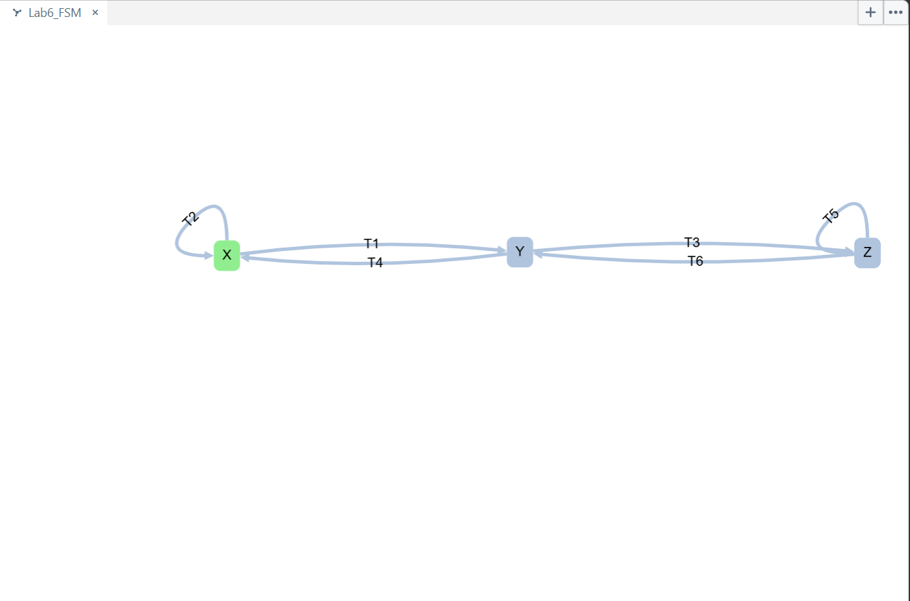

# Lab 6 Reflection

## Problem 1: Test suites
For each test path: input sequence, fired transitions, output sequence.
- TS_s (State coverage): Input Sequence: {aa}, Fired Transitions: {T1, T3}, Output Sequence: {01}
    Justification: The initial state is X, and then an input of 'a' triggers T1 moving the current
    state to Y, and another 'a' triggers T3 moving it to Z, which covers every possible state.
- TS_t (Transition coverage): Input Sequence: {aaabbb}, Fired Transitions: {T1, T3, T5, T6, T4, T2}, Output Sequence: {010101}
    Justification: The inputting 3 'a's in a row triggers T1, T3, and T5, then inputting 3 'b's in a row
    triggers T6, T4, and T2 which covers all possible transitions.
- TS_tt (Transition tree, with the tree): Input Sequence: {'a', 'b', 'aa', 'ab', 'aaa', 'aab'}, Fired Transitions: {'T1', 'T2', 'T1, T3', 'T1, T4', 'T1, T3, T5', 'T1, T3, T6'}, Output Sequence: {'0', '1', '01', '00', '010', '011'}
    Justification: 

## Problem 2: Seeded fault #1 (output fault)
TS_s: This does not reveal the fault because even thought every state is covered it missed T6 where the fault happens.
TS_t: This does reveal the fault since T6 is reached after the fourth input.
TS_tt: This does reveal the fault because the test path 'aab' fires T6.

## Problem 3: Seeded fault #2 (state-transfer fault)
TS_s: This does not reveal the fault on output alone because the input sequence 'aa' fired T1 an T3 which produces
    the output '01' which is the same as the correct version.
TS_t: This does reveal the fault because the outputs change. For the correct version the output is
    '010101' and the faulted version is '010011'.
TS_tt: This does not reveal the fault because even though the suite does contain paths that execute T3, none of them
    provide a different output compared to the correct version.

## Problem 4: Characterization sequences
(a) Input 'a': Start in X, moves to Y, outputs 0
               Start in Y, moves to Z, outputs 1
               Start in Z, moves to Z, outputs 0
Therefore this is not a characterization sequence because X and Z both produce an output of '0'.
    Input 'b': Start in X, moves to X, outputs 1
               Start in Y, moves to X, outputs 0
               Start in Z, moves to Y, outputs 1
Therefore this is also not a characterization sequence because both X and Z produce an output of '1'.
    Input 'ab': Start in X, moves to X, outputs 00
                Start in Y, moves to Y, outputs 11
                Start in Z, moves to Y, outputs 01
Therefore this is a characterization sequence because each output uniquely identifies the starting state.

(b) Fault #1:
TS_s: This now reveals the fault because the new path 'aaab' now fires T6 which contains the fault.
TS_t: This still reveals the fault by firing T6.
TS_tt: This also still reveals the fault by firing T6.

Fault #2:
TS_s: This now reveals the fault because the new faulted output is '0100' whereas the new correct output is '0101'.
TS_t: This still reveals the fault with the faulted output now being '01001100' and the correct output being '01010100'.
TS_tt: This now reveals the fault because the appended inputs are able to change the expected outputs in the fault versions.

The overall lesson is that appending a characterization sequence to test paths ensure that state and transfer
faults do not go undetected because they provide a unique output for each possible state that the sequence starts in.

## Problem 5: GraphWalker

Generated Paths output using GraphWalker:
{"currentElementName":"X"}
{"currentElementName":"T1"}
{"currentElementName":"Y"}
{"currentElementName":"T3"}
{"currentElementName":"Z"}
{"currentElementName":"T6"}
{"currentElementName":"Y"}
{"currentElementName":"T4"}
{"currentElementName":"X"}
{"currentElementName":"T2"}
{"currentElementName":"X"}
{"currentElementName":"T1"}
{"currentElementName":"Y"}
{"currentElementName":"T4"}
{"currentElementName":"X"}
{"currentElementName":"T2"}
{"currentElementName":"X"}
{"currentElementName":"T2"}
{"currentElementName":"X"}
{"currentElementName":"T1"}
{"currentElementName":"Y"}
{"currentElementName":"T4"}
{"currentElementName":"X"}
{"currentElementName":"T1"}
{"currentElementName":"Y"}
{"currentElementName":"T3"}
{"currentElementName":"Z"}
{"currentElementName":"T6"}
{"currentElementName":"Y"}
{"currentElementName":"T4"}
{"currentElementName":"X"}
{"currentElementName":"T2"}
{"currentElementName":"X"}
{"currentElementName":"T2"}
{"currentElementName":"X"}
{"currentElementName":"T1"}
{"currentElementName":"Y"}
{"currentElementName":"T4"}
{"currentElementName":"X"}
{"currentElementName":"T1"}
{"currentElementName":"Y"}
{"currentElementName":"T4"}
{"currentElementName":"X"}
{"currentElementName":"T2"}
{"currentElementName":"X"}
{"currentElementName":"T1"}
{"currentElementName":"Y"}
{"currentElementName":"T3"}
{"currentElementName":"Z"}
{"currentElementName":"T6"}
{"currentElementName":"Y"}
{"currentElementName":"T3"}
{"currentElementName":"Z"}
{"currentElementName":"T5"}
{"currentElementName":"Z"}

Comparison of the generated paths with TS_t:
Yes both the generated test path and my manually-made test path covers all the transitions
which achieves 100% edge coverage. However, th concrete paths were different because GraphWalker
uses a random edge coverage strategy which ends up covering some edges more than once 
whereas my test paths cover each transition in a specific sequence.